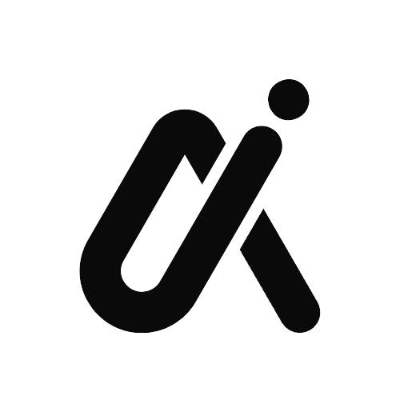
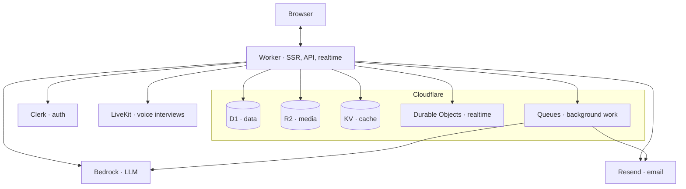
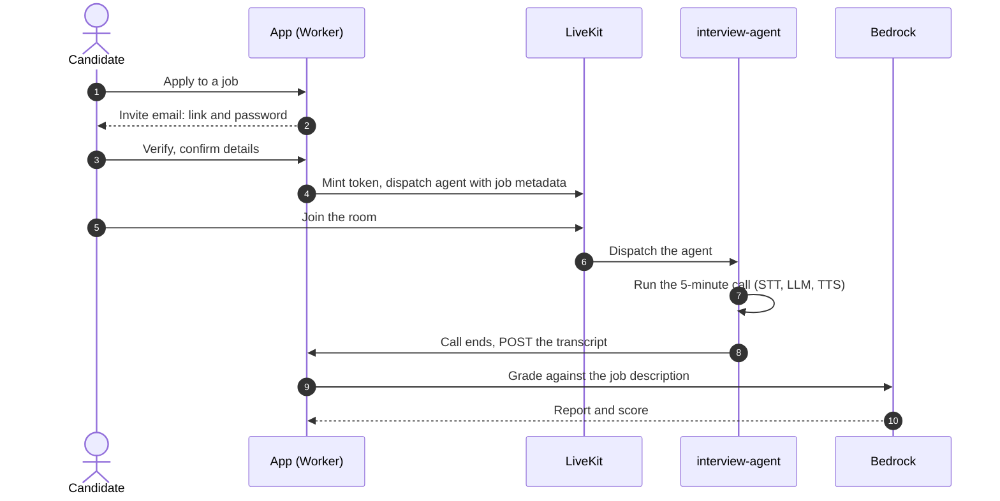

<p align="center">
  <picture>
    <source media="(prefers-color-scheme: dark)" srcset="public/logo-dark.png">
    
  </picture>
</p>

<h1 align="center">Hire Excellence</h1>

<p align="center">
  A professional network where AI runs the first interview.<br>
  <a href="https://hire-excellence.n1m35h.in">hire-excellence.n1m35h.in</a>
</p>

---

## Features

- **AI voice interviews:** a 5-minute LiveKit interview, graded against the job description
- **MCQ screening:** AI-generated or hand-written, with a server-side timer and grading
- **Jobs:** post, apply, and track applicants through a simple pipeline
- **Network & feed:** connections, follows, posts, realtime updates
- **Resume:** upload a PDF and your profile fills itself in
- **Company pages:** verified by work email, one page per domain

## Architecture



Next.js 16 on [vinext](https://github.com/cloudflare/vinext) deploys as one Cloudflare Worker, styled with Tailwind v4. D1 holds the data, R2 the media, KV a read-mostly cache, and a Durable Object pushes realtime feed updates over WebSockets. Slow work (AI grading, invite emails, notification fan-out) goes through Queues back into the same Worker, retried with backoff and parked in a dead-letter queue when it keeps failing.

## Voice interview



The app mints a LiveKit token whose room config dispatches [interview-agent](interview-agent/README.md) with the job, candidate and questions as metadata. The agent runs the call (5-minute hard limit) on LiveKit Inference: AssemblyAI streaming STT, Gemma 4 31B, Inworld TTS, no extra keys. When the call ends it POSTs the transcript to `/api/interview/complete`, a queue grades it with Bedrock, and the poster gets the report.

## Getting started

```bash
git clone https://github.com/GitNimay/hire-excellence.git
cd hire-excellence
npm install
npm run db:migrate:local
npm run dev
```

Add your keys to `.env.local` (Clerk, Bedrock, Resend, LiveKit, Turnstile) and point `wrangler.jsonc` at your own D1 and KV IDs.

## Scripts

| Command | |
|---|---|
| `npm run dev` | Dev server on :3000 |
| `npm test` | Unit tests |
| `npm run typecheck` | Type check |
| `npm run deploy` | Build, migrate, deploy |

---

<p align="center"><sub>Emoji reactions adapted from <a href="https://github.com/swamimalode07/rare-ui">rare-ui</a> · All rights reserved.</sub></p>
