# AI interview: how it works end to end (Phonic + harness)

Traced from the code on `feat/interview-room-v2`. Main files:

| Piece                                                         | File                                                                        |
| ------------------------------------------------------------- | --------------------------------------------------------------------------- |
| Routes (`/interview/<slug>/room\|warm\|rec\|enter`)           | `worker/index.ts`                                                           |
| The room (Durable Object `InterviewRoom`)                     | `worker/ai-interview-room.ts`                                               |
| Harness: phases, clock, gates, tools, wakes, prompts          | `lib/ai-interview/harness.ts`                                               |
| Plan, room context, bookkeeping, text fallback, evaluator I/O | `lib/ai-interview/session.ts`                                               |
| Evaluator (pure scoring)                                      | `lib/ai-interview/evaluator.ts`                                             |
| Coding problems / sandbox                                     | `lib/ai-interview/problem-gen.ts`, `problem-bank.ts`, `sandbox.ts` (Judge0) |
| Candidate UI (steps, audio worklets, proctoring, recording)   | `components/ai-interview/candidate.tsx`, `workspace.tsx`                    |

The core idea: **Phonic is only the voice and the conversational model.** Everything that decides anything (which phase, which tools exist, whether a move is allowed, when to speak unprompted, what gets scored) lives in the harness inside the Durable Object. The browser never talks to Phonic and never sees a tool call, so it can't forge one.

---

## 1. The whole lifecycle

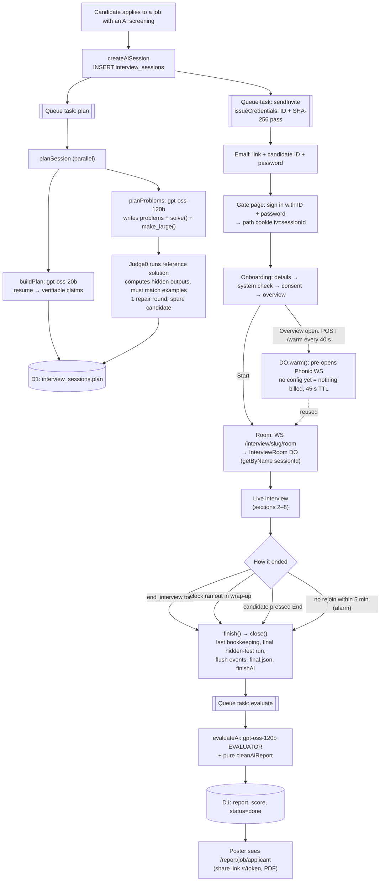

If the plan task hasn't finished when the candidate joins, `roomContext` builds claims on the spot and uses three built-in problems from `problem-bank.ts` instead of generated ones.

### Coding tracks and environments

The coding round is about one or more **tracks**: general code (any of six languages, the candidate picks) or a DevOps / data environment with a fixed file: Bash, SQL (SQLite), YAML (Kubernetes, CI/CD, Compose), Dockerfile, Terraform, JSON (IAM policies). The recruiter can pin up to three in the post form; otherwise `pickTracks()` reads them from the job description (weighted double) and the resume. An infrastructure or data role leads with its environments and never gets algorithms only.

`planProblems` writes three problems: the primary (main track, role level), a like-for-like backup (next track), and an easier one (main track, one level down). A slot whose problem is rejected after three tries is filled in place from the bank, so the order always holds.

| Environment           | How it's graded                                                                                                                       |
| --------------------- | ------------------------------------------------------------------------------------------------------------------------------------- |
| code                  | Judge0, multi-case stdin, line by line (unchanged)                                                                                    |
| Bash, SQL             | Judge0's Bash image (it has sqlite3), one submission: a driver splits stdin per case and runs the file on each; whole output per case |
| YAML, JSON            | `lib/ai-interview/checks.ts` in the Worker: parsed, then path assertions (`spec.template.spec.containers[*].resources.limits.memory`) |
| Dockerfile, Terraform | `checks.ts`: regex assertions on the text (no parser or binary on the free tier)                                                      |

Generated environment problems are proven like code ones: script references run on Judge0 to produce every hidden output and must reproduce the examples; config references must pass every check and the starter must fail at least two. `npm run eval` includes `tests/evals/env-problems.eval.ts`, which generates a DevOps and an SRE round on the real models.

---

## 2. Who talks to whom

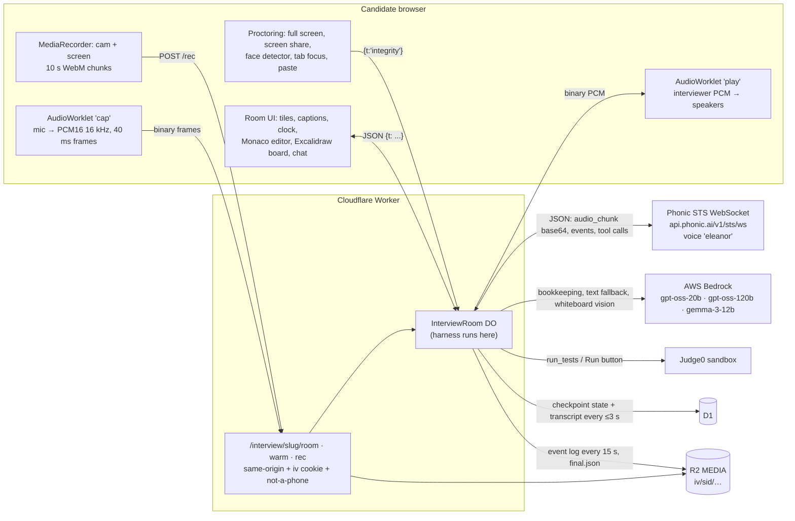

---

## 3. Joining: browser → DO → Phonic

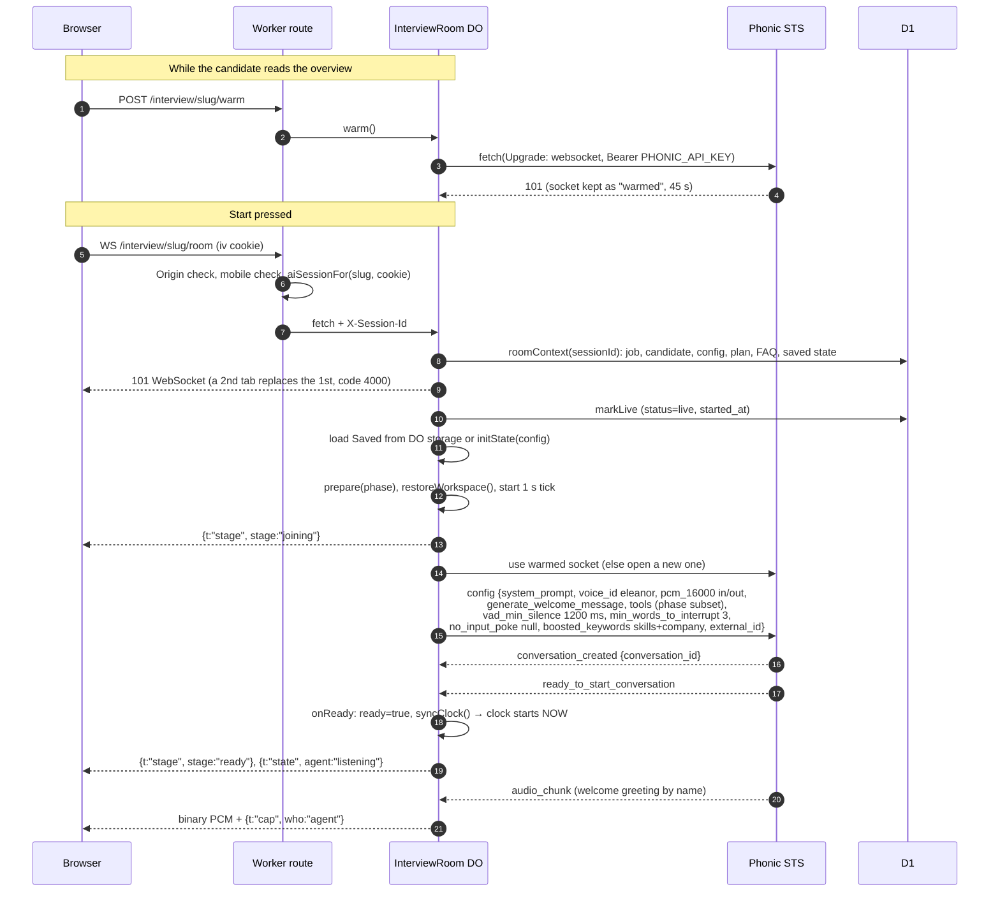

`systemPrompt(phase, ctx, state)` goes in **once**, in `config`. Phonic refuses `update_system_prompt` after the first, so every later phase change is done with `update_tools_subset` + `add_system_message` (section 5).

The prompt contains: the role and company, the candidate's name/skills, the plan's resume claims, the FAQ (location, pay, next steps…), the current phase brief, and memory (rolling summary + last 8 lines) when it's a fresh conversation after a drop.

---

## 4. One conversational turn (the hot path)

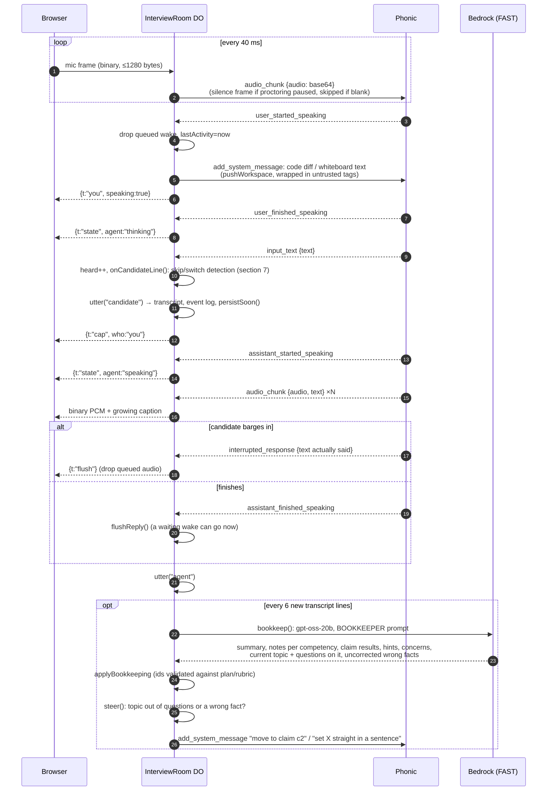

**Why bookkeeping is a background model, not tools:** when the voice agent had `add_note` / `record_claim_result` / `flag_concern` tools it kept saying "let me note that down". Now the agent has nothing to write; a separate fast model reads the transcript every 6 lines in parallel and produces the evidence the evaluator later cites.

### Keeping the conversation moving (issue #130)

Candidates found the interviewer boring and robotic: it drilled into the first project it heard about, repeated each answer back before the next question, and kept asking around wrong answers. Two layers fix it:

1. **The prompt** (`BASE`, phase briefs): never restate or paraphrase the candidate's answer (react in a few words or not at all, varied, never praise); a topic gets its opening question and at most two follow-ups (a third only if the answers stayed vague), then a short bridge to a new one; the deep dive covers two or three projects or claims (about two minutes each) and the technical round two or three areas; a clearly wrong technical fact is set straight in one kind sentence (or the candidate is asked once if they're sure), then the interviewer moves on. That clarification is not performance feedback, and coding still uses the hint ladder.
2. **The harness backstop** (`steer` in `harness.ts`): the bookkeeper also names the topic of the newest lines (continued or new, and how many questions it got) and lists wrong facts the interviewer let pass. The harness keeps `state.topic` (reset every phase). In the deep dive and technical rounds, once a topic reaches `TOPIC_QUESTIONS` (3) it sends one private note to move on, pointing at a resume claim nobody has covered yet (not while the whiteboard is open: the design discussion is one topic by design). A flagged wrong fact gets a note to set it straight briefly. Notes are context only (`add_system_message`), so the agent applies them at its next turn and never speaks unprompted; in text fallback they ride along with the next typed reply. Each one is logged as a `session` / `steer` event.

The bookkeeper is told that a brief correction is not a hint (the wrong answer is a note), and the evaluator counts a corrected wrong answer as a miss, not as a hint. `npm run eval` includes `tests/evals/interviewer.eval.ts`, which replays scripted conversations through the interviewer prompt on the real model and checks the reply for echoing, topic changes and corrections.

---

## 5. Tool calls

### 5a. Which tools exist in which phase

`toolsFor(phase, {design})` decides; the DO sends that subset in `config` and again with `update_tools_subset` on every phase change. Every tool is a Phonic `custom_websocket` tool, `execution_mode: sync`, strict OpenAI function schema.

| Tool                       | Phases                   | Params                                               | Run by                  | Timeout | What it does                                                                                                              |
| -------------------------- | ------------------------ | ---------------------------------------------------- | ----------------------- | ------- | ------------------------------------------------------------------------------------------------------------------------- |
| `request_phase_transition` | all                      | `initiated_by` goal_met \| candidate_asked, `reason` | harness (`applyTool`)   | 10 s    | Ask to move on. Gated (5c). If approved the move happens **inside** the call.                                             |
| `switch_problem`           | coding                   | `level` similar \| easier, `reason`                  | harness + room          | 10 s    | Swap to a backup (similar) or the easier problem. Needs the candidate's confirmation (two-step). At most two swaps.       |
| `read_editor`              | coding                   | —                                                    | room                    | 10 s    | Current code (≤8 000 chars), diff since last look, idle seconds.                                                          |
| `run_tests`                | coding                   | `suite` visible \| hidden                            | room → Judge0           | 60 s    | Runs code. Agent gets pass counts + **names** of failing cases, never hidden inputs/outputs.                              |
| `open_whiteboard`          | technical (if design on) | `topic`, `requirements` (`;`-separated)              | room                    | 10 s    | Opens Excalidraw with the question; new topic = clean board.                                                              |
| `read_whiteboard`          | technical (if design on) | —                                                    | room (+ Bedrock vision) | 30 s    | Board as components + connections; if freehand strokes exist, asks the browser for a PNG and has gemma-3-12b describe it. |
| `close_whiteboard`         | technical (if design on) | —                                                    | room                    | 10 s    | Closes the board (also auto-closed when leaving Technical).                                                               |
| `end_interview`            | wrap-up                  | —                                                    | harness                 | 10 s    | Ends after the goodbye finishes playing.                                                                                  |

### 5b. The path of every tool call

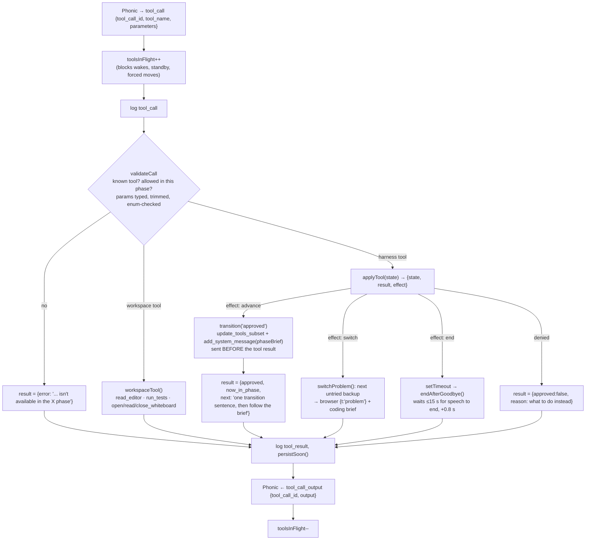

No `generate_reply` is sent after an approved transition: the agent is already mid-turn, and a second prompt made it talk twice. The new brief simply lands in its context before the tool result does.

### 5c. Transition gates (`requestTransition`)

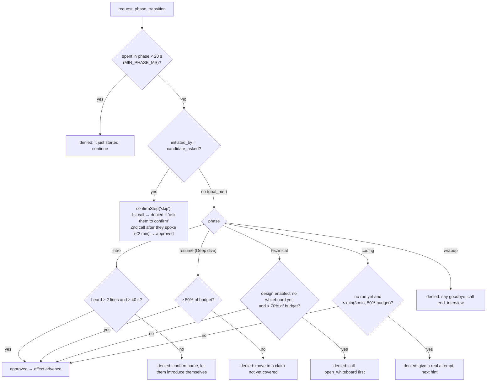

---

## 6. Phases and the clock

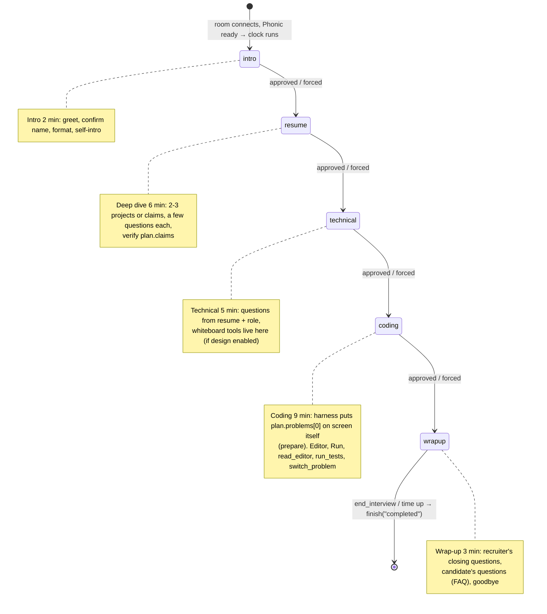

Defaults sum to 25 min (`LIMITS.maxTotalMinutes`); the poster can drop coding or technical, and `cleanConfig` shrinks longer configs proportionally.

**The clock** (`syncClock`) runs only when _all_ hold: candidate connected, interviewer ready (or standby / resuming / text fallback), no proctoring pause. So reconnects and pauses never eat the candidate's time.

**Every 1 s `onTick`:**

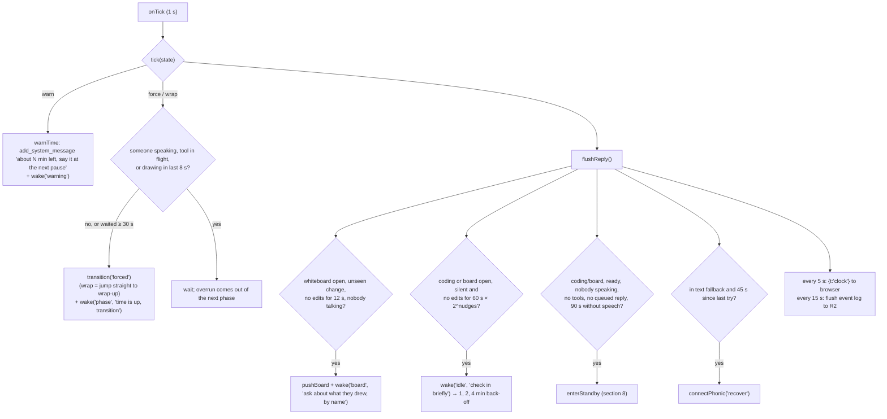

Flexible timing (`RoleConfig.timing = flexible`): phases are a guide, never forced; one warning 2 min before wrap-up must start, then `wrap` jumps to wrap-up; hard limit 60 min.

---

## 7. Wakes, and how the agent is made to speak unprompted

The agent normally only speaks after the candidate does. The harness makes it speak with a **wake**:

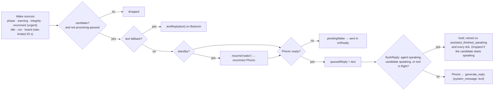

`add_system_message` = put a fact in the agent's context (it will use it on its next turn). `generate_reply` = make it talk now. The harness uses the first for briefs/code/board/time notes and the second only through this queue, so the interviewer never talks over itself.

### Skips and problem switches are the candidate's call

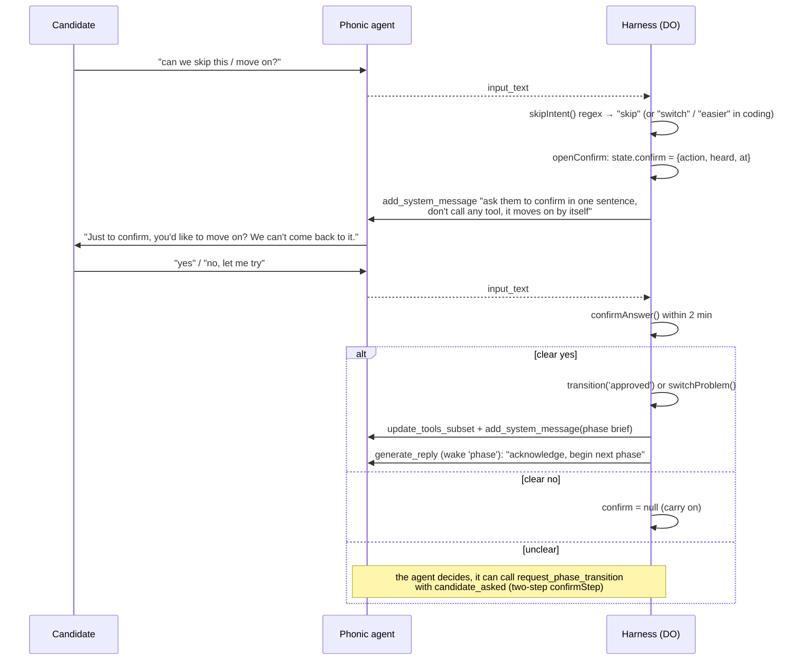

---

## 8. Voice resilience, standby and fallback

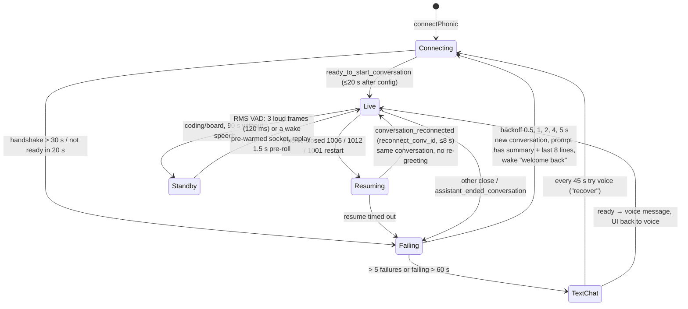

- **Text fallback** (`textTurn`): same system prompt and same phase tools, but on Bedrock gpt-oss-20b with tool calling; tools still go through `runTool`, so every gate applies.
- **Standby** saves cost: Phonic bills per open minute (~$0.07/min, ~99% of spend), and coding is mostly silent. The clock keeps running in standby.
- **Candidate drops:** Phonic is kept open 30 s (tab flip = no re-greeting); the browser auto-rejoins up to 3× before sending them to the device check; the DO alarm ends the interview as "abandoned" after 5 min.
- **Proctoring hard signal** (full-screen exit, extra monitor, face absent): clock paused, mic replaced by silence, interviewer audio flushed; on clear, `wake('integrity')` "continue, don't accuse".

---

## 9. Ending and evaluation

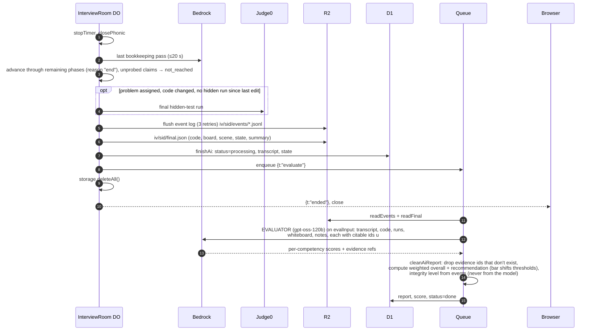

---

## 10. Trust boundaries (why it's built this way)

- **Tool calls never cross the browser.** Phonic ⇄ DO only. The browser sends mic audio, code, board, Run, chat (fallback only), integrity, End.
- **Candidate-controlled text is wrapped** in `untrusted(label, …)` tags before it reaches any model (code, diffs, run errors, whiteboard, vision description).
- **Hidden tests stay server-side**: `problem-bank.ts` is server-only (a unit test greps client imports); `publicProblem()` strips hidden cases; `run_tests` returns only failing case names.
- **Validation before effects**: `validateCall` rejects unknown / out-of-phase tools and bad params; bookkeeping and evaluator output are cleaned against the real plan, rubric and evidence ids.
- **Scores are computed, not generated**: overall, recommendation and integrity level are code.
